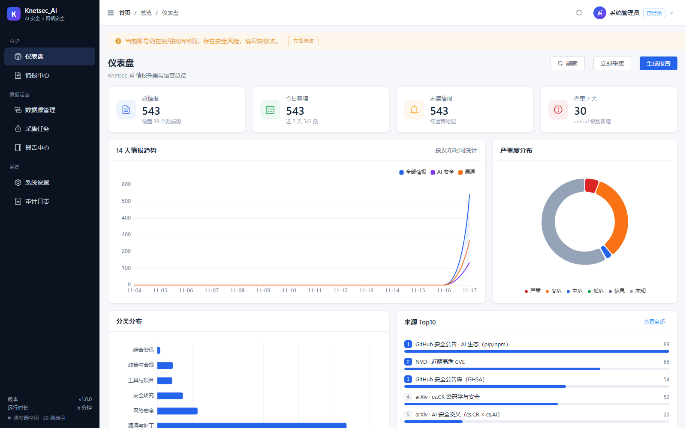
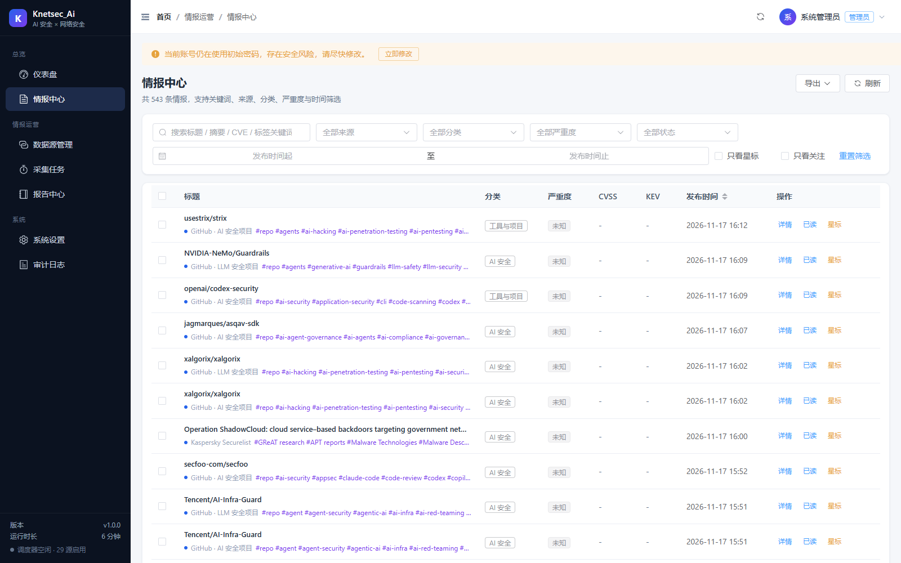
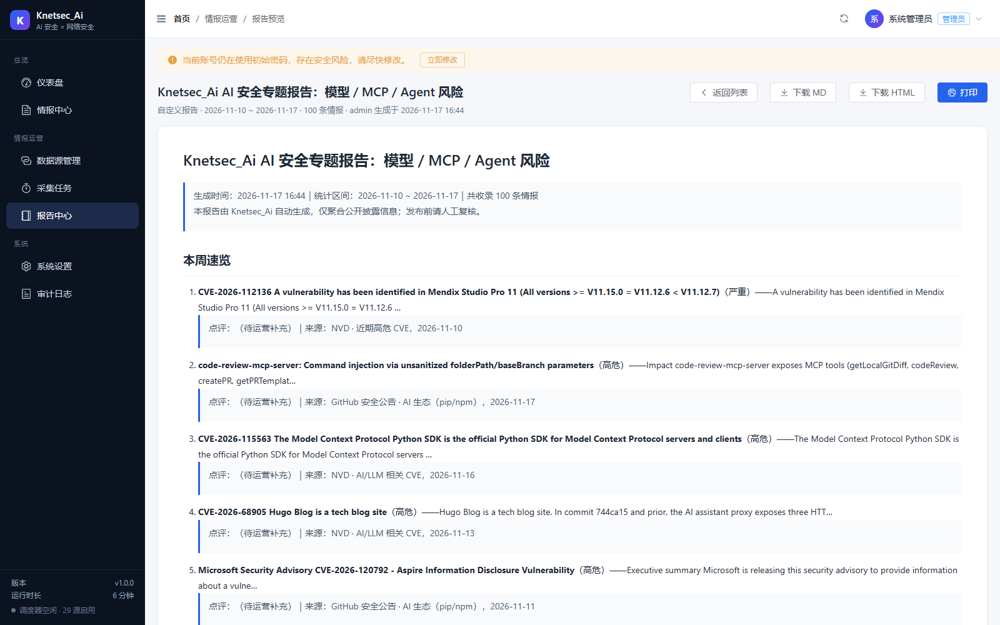
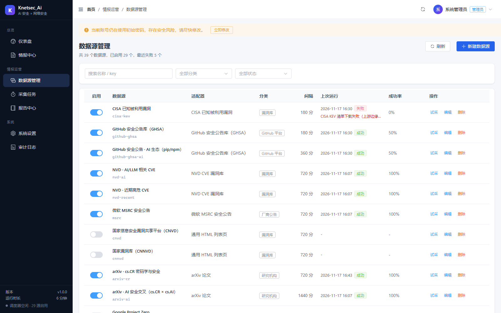

# Knetsec_Ai

> **AI 安全 × 网络安全实时情报平台**：多源采集 → 自动去重打标 → 自动周报 → 中文管理面板。

[]()
[]()
[]()
[]()

---

## 这是什么

Knetsec_Ai 面向「AI × 网络安全」内容运营与安全从业者，解决情报收集的四个痛点：**入口分散、重复严重、时效滞后、无法沉淀**。

- **多源实时采集**：GitHub 安全公告/仓库/Releases、NVD CVE、CISA KEV、微软 MSRC、厂商 PSIRT、arXiv、安全媒体等 20+ 数据源；
- **自动整理**：归一化 → 去重（UID + CVE/GHSA + 标题相似度）→ 分级打标（CVSS/KEV/AI 安全词典）→ 入库；
- **自动报告**：日报/周报/月报/专题报告，输出 Markdown + 可打印 HTML；
- **管理面板**：仪表盘、情报中心、数据源管理、任务调度、报告中心、系统设置、审计日志；
- **可运维**：单命令启动、SQLite 单文件存储、结构化日志、运行记录可回放。

## 快速开始

```powershell
# 1. 安装依赖（自动构建共享类型包）
cd D:\Knetsec_Ai
npm install

# 2. 配置（可选，复制后修改管理员密码、GitHub Token 等）
Copy-Item .env.example .env

# 3. 开发模式（server:8787 + web:5173 热更新）
npm run dev

# 4. 生产模式（构建后由 server 托管前端）
npm run build
npm start
```

打开 <http://127.0.0.1:8787>，默认账号 `admin / admin123`（首次登录后请立即修改密码）。

## 常用命令

| 命令 | 说明 |
|---|---|
| `npm run dev` | 同时启动服务端与前端开发服务器 |
| `npm run build` | 构建 shared、server、web |
| `npm start` | 生产模式启动（含前端静态托管） |
| `npm test` | 运行服务端单元/集成测试 |
| `npm run typecheck` | 全仓 TypeScript 类型检查 |
| `npm run lint` | ESLint 检查 |
| `npm run verify:sources` | 实测所有数据源可达性 |
| `npm run smoke` | 端到端冒烟（登录→采集→查询→报告） |
| `npm run seed` | 补齐默认管理员/设置/数据源 |

## 目录结构

```
Knetsec_Ai/
├── apps/server       # Fastify 服务端：API、采集流水线、调度、报告
├── apps/web          # Vue3 管理面板
├── packages/shared   # 前后端共享类型与契约
├── docs/             # 00-09 全套中文文档
├── deploy/           # Docker / Windows 部署脚本
├── scripts/          # 开发、实测、冒烟脚本
└── data/             # 运行期数据（SQLite、报告、日志，自动创建）
```

## 文档

| 文档 | 内容 |
|---|---|
| [00 项目总览与架构契约](docs/00-项目总览与架构契约.md) | 目录边界、数据模型、API、采集器接口 |
| [01 可行性研究报告](docs/01-可行性研究报告.md) | 可行性、数据源实测、选型、风险 |
| [02 需求规格说明书](docs/02-需求规格说明书.md) | FR/NFR、验收标准 |
| [03 总体架构设计](docs/03-总体架构设计.md) | 分层、模块、数据流、安全 |
| [04 数据源接入与采集设计](docs/04-数据源接入与采集设计.md) | 适配器、源清单、实测结果 |
| [05 管理面板设计](docs/05-管理面板设计.md) | 信息架构、组件、交互 |
| [06 部署与运维手册](docs/06-部署与运维手册.md) | 安装、备份、排障、加固 |
| [07 测试与验收报告](docs/07-测试与验收报告.md) | 用例、结果、缺陷 |
| [08 项目全生命周期落地报告](docs/08-项目全生命周期落地报告.md) | 从 0 到上线的全过程 |
| [09 API 接口文档](docs/09-API接口文档.md) | 逐端点参数与示例 |
| [10 GitHub 发布与仓库运维](docs/10-GitHub发布过程与仓库运维指南.md) | 发布过程记录、协作命令、排障 |

## 界面预览

| 仪表盘 | 情报中心 |
|---|---|
|  |  |

| 报告预览 | 数据源管理 |
|---|---|
|  |  |

> 更多截图见 [docs/assets](docs/assets/)；两篇核心报告另提供 Word 版：
> [01 可行性研究报告](docs/exports/Knetsec_Ai-01-可行性研究报告.docx) ｜ [08 项目全生命周期落地报告](docs/exports/Knetsec_Ai-08-项目全生命周期落地报告.docx)

## 安全与合规

- 仅聚合**公开披露**的安全信息，只保存标题、摘要与原文链接，不全文转载；
- 不提供漏洞利用代码，不对任何目标做未授权测试；
- 默认仅监听 `127.0.0.1`，公网部署请使用反向代理 + TLS 并立即修改默认密码；
- 报告发布前请人工复核。

## License

内部项目，未授权不得对外分发。